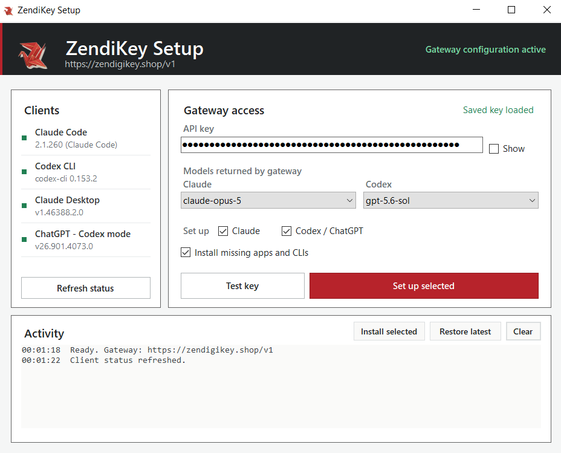

# ZendiKey Setup

Cài đặt ZendiKey cho Codex CLI và app ChatGPT (Codex mode) trên Windows. Dùng được cả key **GPT** lẫn key **GEMINI (Antigravity)**.



## Cách sử dụng

1. [Tải ZendiKeySetup.exe](https://github.com/k1n93r/ZendiKeySetup/releases/latest/download/ZendiKeySetup.exe).
2. Mở file vừa tải và dán **mã ZEN-XXX-XXX-XXX** (hoặc API key `sk-...`).
3. Bấm **Test key**: ứng dụng kiểm tra key, báo app nào chưa cài (Codex CLI, app ChatGPT, Claude Code, Claude Desktop) và cho bạn chọn cài cái nào.
4. Tick **Codex** / **Claude** tùy key, bấm **Set up selected** và chờ thông báo hoàn tất.
5. Mở app ChatGPT (Codex mode), gõ `codex` hoặc `claude` trong terminal mới, hoặc mở Claude Desktop để dùng.

Ứng dụng tự đổi mã lấy key, kiểm tra key, chọn model tốt nhất của key (GPT, Gemini hoặc Claude), cài thành phần còn thiếu và hiển thị gói / số dư / hạn dùng của key.

- **Codex CLI** được tải thẳng từ GitHub (bản standalone, không cần Node.js, không cần quyền admin) vào `%LocalAppData%\Programs\Codex`. Máy đã có npm thì cài qua npm.
- **App ChatGPT** cài qua Microsoft Store (winget). Nếu winget lỗi, ứng dụng tự mở trang Store đúng app, bạn chỉ cần bấm Install.
- **Claude Code** (`~/.claude/settings.json`) và **Claude Desktop** (cấu hình gateway) trỏ về `https://api.zendigikey.shop`; key được giữ trong credential helper của ứng dụng, không ghi thẳng vào file. Trong Claude Code, `/model opus`, `sonnet`, `haiku` lần lượt là claude-opus-5.5, claude-sonnet-5.5, claude-haiku-4.5 (theo key).
- Nút **Reset to default** gỡ toàn bộ cấu hình ZendiKey khỏi Codex CLI / app ChatGPT (app vẫn còn, đăng nhập tài khoản riêng bình thường). **Restore latest** đưa cấu hình ZendiKey trở lại.

## Mở bằng link

Sau lần chạy đầu tiên, ứng dụng đăng ký link dạng `zendikey://`. Bấm link
`https://zendigikey.shop/check?code=ZEN-XXX-XXX-XXX` rồi **Install on this PC** (hoặc `zendikey://ZEN-XXX-XXX-XXX`)
sẽ mở ứng dụng với mã đã điền sẵn và tự chạy cài đặt.

Nếu Windows hiện cảnh báo SmartScreen, chọn **More info** rồi **Run anyway**.

## Dòng lệnh

```
ZendiKeySetup.exe --status                 # trạng thái app + cấu hình
echo ZEN-XXX-XXX-XXX | ZendiKeySetup.exe --apply-stdin   # cài Codex không cần giao diện
ZendiKeySetup.exe --install-missing        # cài Codex CLI + app ChatGPT nếu thiếu
ZendiKeySetup.exe --install-codex-portable # ép cài Codex CLI bản standalone
ZendiKeySetup.exe --reset-default          # gỡ cấu hình ZendiKey, trả Codex/ChatGPT về mặc định gốc
ZendiKeySetup.exe --restore-latest         # khôi phục cấu hình trước khi cài
```
