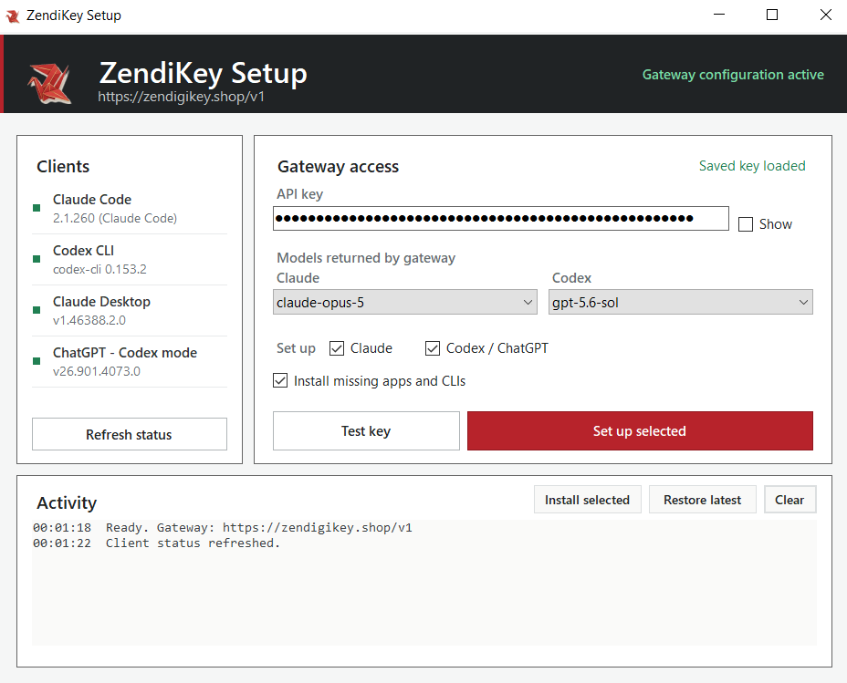

# ZendiKey Setup

Cài đặt tự động 1-click ZendiKey cho **Claude Code**, **Claude Desktop**, **Codex CLI** và **app ChatGPT (Codex mode)** trên Windows. Hỗ trợ đầy đủ key **GPT**, **Claude** và **GEMINI (Antigravity)** qua `https://api.zendigikey.shop`.



## Cách sử dụng (1 bước cho khách)

1. [Tải ZendiKeySetup.exe](https://github.com/k1n93r/ZendiKeySetup/releases/latest/download/ZendiKeySetup.exe).
2. Mở file vừa tải và dán **mã ZEN-XXX-XXX-XXX** (hoặc API key `sk-...`; app cũng tự nhận sẵn từ clipboard).
3. Bấm thẳng **Set up now** (hoặc **Check key** trước nếu muốn đổi model mặc định).
4. Mở lại **Claude Desktop** / **app ChatGPT**, hoặc gõ `claude` / `codex` trong terminal mới để dùng.

Ứng dụng tự đổi mã lấy key, tự nhận diện loại key để tick đúng Claude / Codex, chọn model mới nhất của key, cài thành phần còn thiếu và hiển thị gói / số dư / hạn dùng của key.

- **Codex CLI** được tải thẳng từ GitHub (bản standalone, không cần Node.js, không cần quyền admin) vào `%LocalAppData%\Programs\Codex`. Máy đã có npm thì cài qua npm.
- **Claude Code** tự cài qua `winget` hoặc fallback sang `npm` (`~/.claude/settings.json`), còn **Claude Desktop** cấu hình gateway qua `https://api.zendigikey.shop`. Trong Claude Code, `/model opus`, `sonnet`, `haiku` tự map sang bản cao nhất mà key hỗ trợ (ví dụ `claude-opus-5.5`, `claude-sonnet-5.5`, `claude-haiku-5.5`).
- **App ChatGPT** cài qua Microsoft Store (`winget`). Nếu `winget` lỗi, ứng dụng tự mở đúng trang Store để khách bấm Install.
- Nút **Reset to default** gỡ toàn bộ cấu hình ZendiKey khỏi Codex CLI / app ChatGPT (app vẫn còn, đăng nhập tài khoản riêng bình thường). **Restore latest** đưa cấu hình ZendiKey trở lại.

## Mở bằng link

Sau lần chạy đầu tiên, ứng dụng đăng ký link dạng `zendikey://`. Bấm link
`https://zendigikey.shop/check?code=ZEN-XXX-XXX-XXX` rồi **Install on this PC** (hoặc `zendikey://ZEN-XXX-XXX-XXX`)
sẽ mở ứng dụng với mã đã điền sẵn và tự chạy cài đặt.

Nếu Windows hiện cảnh báo SmartScreen, chọn **More info** rồi **Run anyway**.

## Dòng lệnh

```
ZendiKeySetup.exe --status                 # trạng thái app + cấu hình
echo ZEN-XXX-XXX-XXX | ZendiKeySetup.exe --apply-stdin   # cài Codex không cần giao diện
ZendiKeySetup.exe --install-missing        # cài Codex CLI + app ChatGPT nếu thiếu
ZendiKeySetup.exe --install-codex-portable # ép cài Codex CLI bản standalone
ZendiKeySetup.exe --reset-default          # gỡ cấu hình ZendiKey, trả Codex/ChatGPT về mặc định gốc
ZendiKeySetup.exe --restore-latest         # khôi phục cấu hình trước khi cài
```
